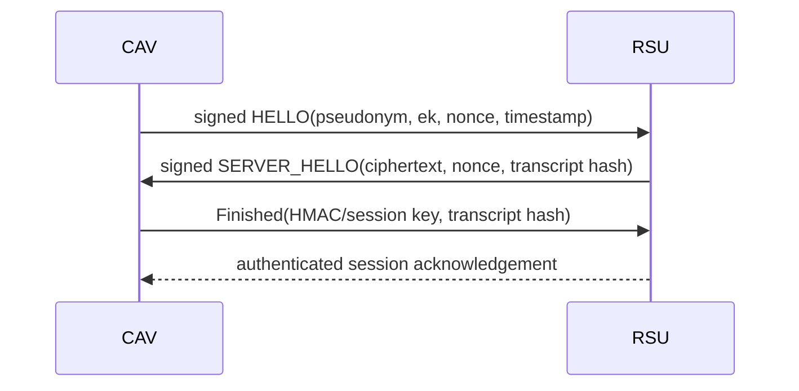
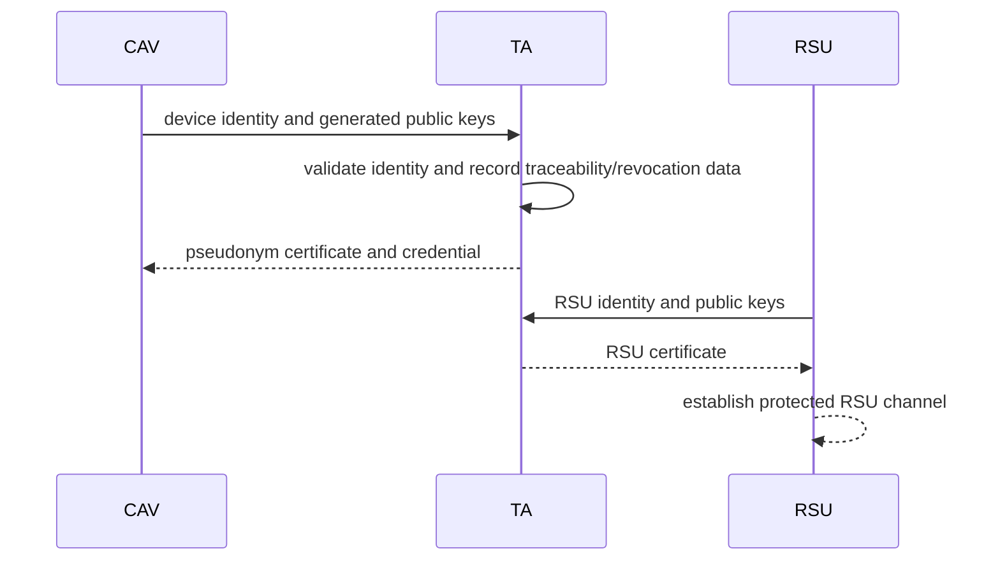
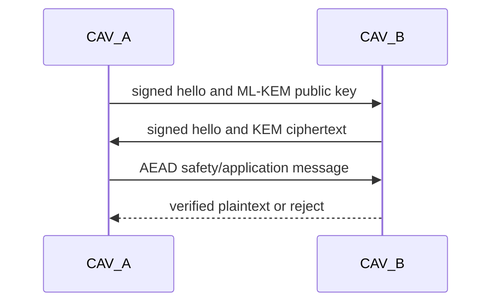
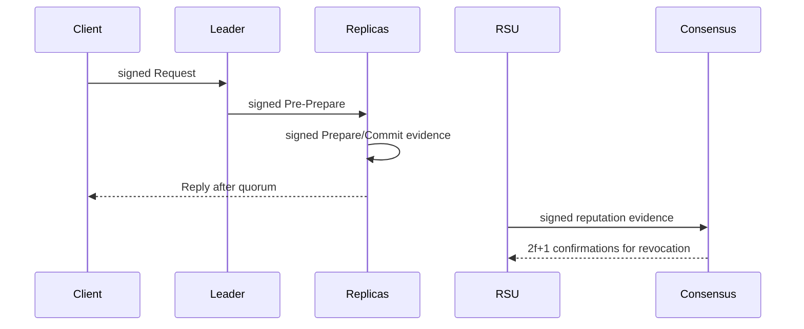
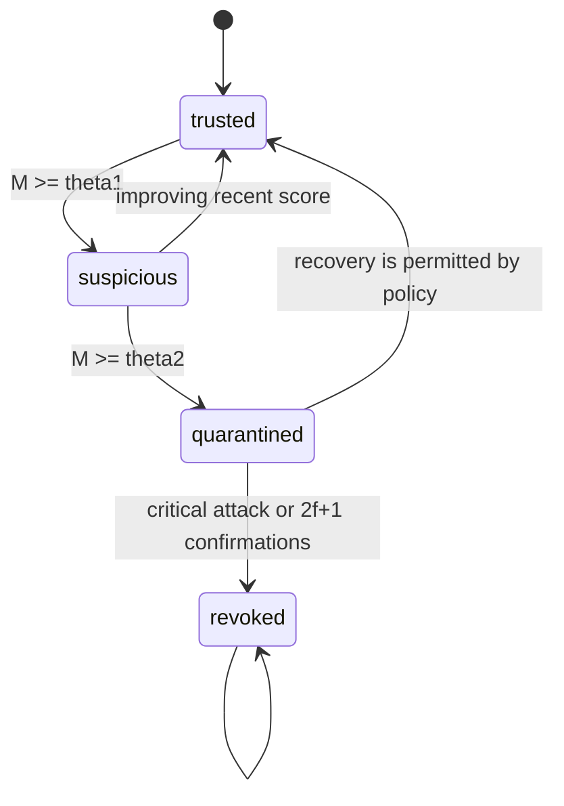

# Protocol Concepts

## Protocol lifecycle

| Phase | Purpose/entities | Inputs and outputs | Crypto/security | Failure/fallback | Evidence |
|---|---|---|---|---|---|
| Registration | TA, CAV/OBU, RSU | Device identity in; certificate, pseudonym and public keys out | ML-DSA/ML-KEM key material and certificate binding | Reject identity; revocation handling is design-only | Registration implementation **NOT FOUND** |
| V2R establishment | CAV and RSU | Signed vehicle hello; signed RSU ciphertext/nonce; Finished tag | ML-KEM encapsulation/decapsulation, ML-DSA, transcript hash, HKDF, HMAC | Freshness/signature/transcript failure closes session | `CAVApp.cc`, `RSUApp.cc`, `v2r_handshake.pv` |
| V2R session | CAV and RSU | Authenticated telemetry/application messages | AEAD is documented; full telemetry path **PARTIALLY FOUND** | Reject invalid tag; safety path should not wait for PBFT | `CavMsg.msg`, protocol docs |
| Handover issuance | Serving RSU, next RSU, CAV | Current session, mobility parameters | Context KDF, ML-DSA token, AEAD RSU context | Invalid prediction/parameters: no offer | `RSUApp.cc` |
| Handover verification | CAV, next RSU | Token, fresh vehicle nonce/signature | Destination, expiry, pseudonym, nonce, signature checks; fresh KDF | Expired/wrong/replayed token: full V2R fallback | `CAVApp.cc`, `RSUApp.cc`, `handover_token.pv` |
| Direct V2V | Two CAVs | Signed hellos, KEM ciphertext, AEAD data | ML-KEM, ML-DSA, AEAD | Reject verification/decryption failure | `v2v_session.pv`; executable V2V **NOT FOUND** |
| RSU-assisted V2V | Two CAVs and RSU | End-to-end ciphertext relayed by RSU | RSU sees outer metadata only; inner key remains with CAVs | Drop invalid outer/inner messages | Design/model; network result **NOT FOUND** |
| Reputation/PBFT | CAV/RSU consensus nodes | Signed evidence and PBFT messages | ML-DSA signatures; recent/long-term scores | Candidate, quarantine, revocation with 2f+1 | `experiments/reputation_model.py`, PBFT CSV |

## V2R sequence



## Registration sequence



## Handover sequence

```mermaid
sequenceDiagram
 CAV->>RSU_a: authenticated session
 RSU_a->>RSU_a: predict RSU_b; derive K_ctx
 RSU_a->>RSU_b: signed token + AEAD context
 RSU_a->>CAV: token offer
 CAV->>RSU_b: token, fresh nonce, signed request
 RSU_b->>CAV: signed confirmation and fresh nonce
 CAV->>CAV: derive K_i,b
```

## V2V sequence



## PBFT and lifecycle





## Security properties

Confidentiality comes from ML-KEM-derived keys and AEAD; authentication and integrity come from ML-DSA; replay resistance comes from nonces, timestamps, expiry, and one-time token state; transcript substitution is addressed by hashes and signatures. Conditional traceability, secure hardware, and certificate issuance are stated assumptions rather than complete executable evidence. ProVerif supports symbolic secrecy/correspondence claims only.

## Fallback and failure handling

The handover implementation falls back to a full V2R exchange when token validation fails. Credential, signature, freshness, transcript, ciphertext, or key-confirmation failure rejects the message. PBFT quarantine does not itself prove compromise; permanent revocation requires critical evidence or a threshold confirmation in the reputation model. A complete end-to-end failure taxonomy and registration/revocation service are **NOT FOUND**.
