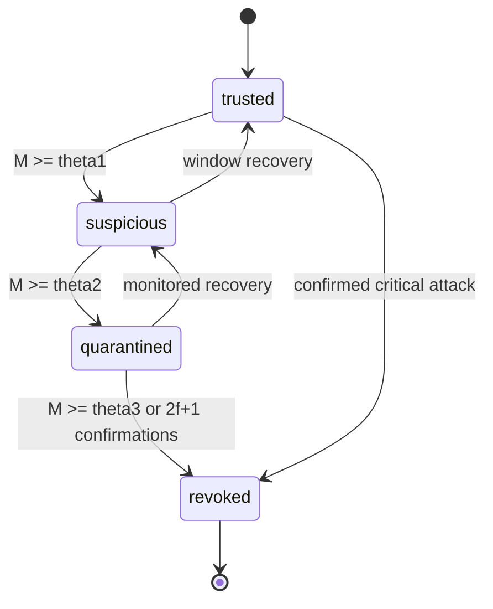

# Phase 08 — Sliding-window reputation-based PBFT

The improved mechanism is explainable and rule-based; it does not use machine learning.

## Baseline versus improved mechanism

The baseline uses one cumulative score, fixed `+1/-5/-2` updates, and reassignment every 50 requests. The improved mechanism maintains recent and long-term scores, a configurable event window, severity-weighted penalties, forgiveness for low/medium temporary faults, dynamic eligibility, and distributed revocation.

## Equations

`delta_i = alpha*g_i - sum(beta_effective(severity)) - gamma*n_i`

`R_recent' = clip((1-lambda_recent)*R_recent + delta_i, 0, 100)`

`R_long' = clip((1-lambda_long)*R_long + delta_i, 0, 100)`

`A_i = valid_events_last_W / evaluated_events_last_W`.

For low/medium faults, `beta_effective = beta(severity)*(1-rho*A_i)`; high/critical faults receive the full penalty. Eligibility uses `T_low=mu-sigma` and `T_high=mu+sigma`, with `CN >= 3f+1` enforced.

## Severity and lifecycle

Low: delayed-valid or optional miss (-1); medium: required miss (-2) or invalid freshness (-3); high: conflicting PREPARE/COMMIT (-5); critical: invalid signature, Sybil, false position (-15), collusion (-20). Maliciousness weights are low=.2, medium=.5, high=1, critical=2. Thresholds are trusted `<1`, suspicious `1–2`, quarantined `2–4`, revoked `>=4` or confirmed critical evidence.

Revocation records include pseudonym, evidence hashes, severity, reporters, timestamp, confirmation count, decision, and ML-DSA signatures. A single RSU cannot revoke a node.
